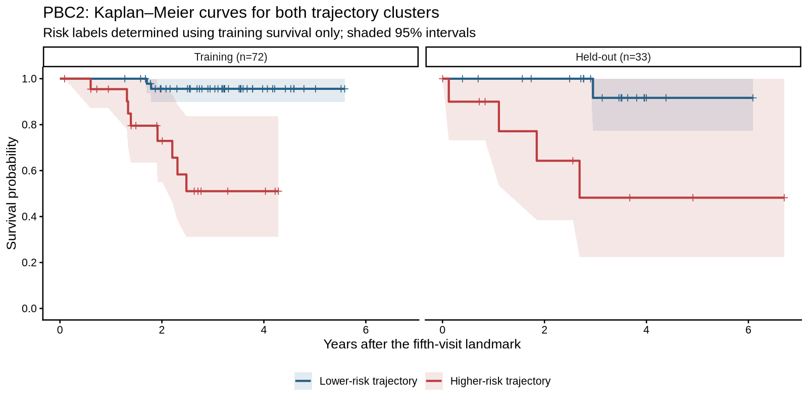
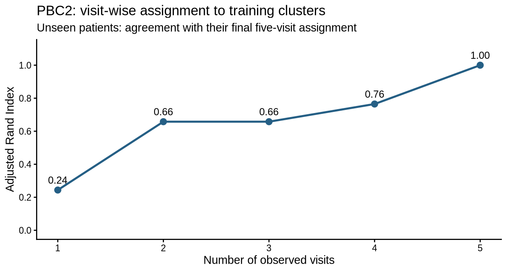
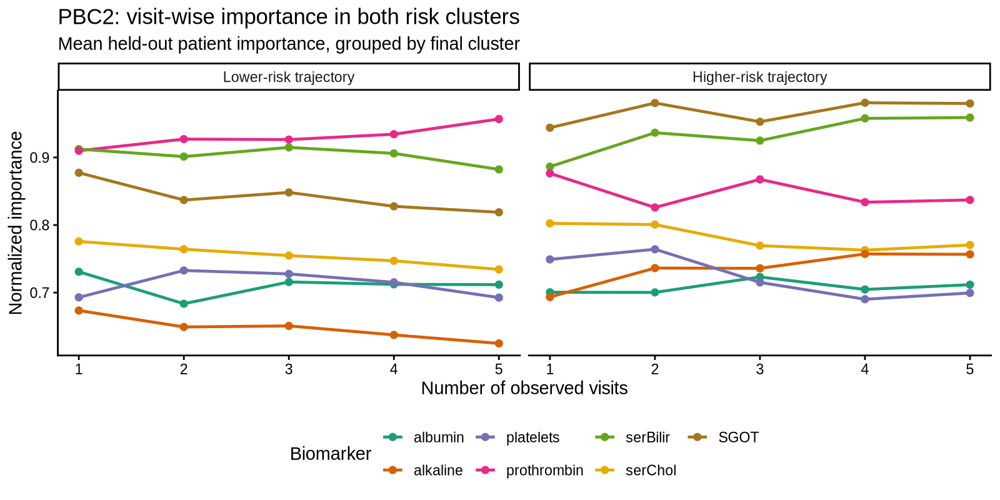
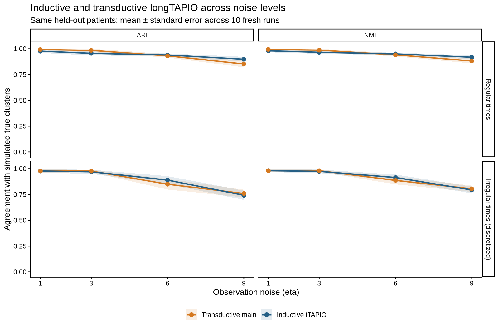

# iTAPIO

Inductive clustering with `TAPIO()` and `longTAPIO()`: fit reference clusters,
assign new samples or patients without refitting, and track assignments and
feature importance as visits arrive.

## Install

```r
install.packages("remotes")
remotes::install_github("pievos101/TAPIO", ref = "inductive")
library(iTAPIO)
```

From a local checkout: `R CMD INSTALL .`. Evaluation uses `aricode`; PBC2 plots
also use `survival` and `survminer`. PBC2 and Iris ship with iTAPIO; DynForest is
not needed. No examples initialize a fixed random seed, so results vary by run.

## Samples

```r
library(iTAPIO)
data(iris, package = "iTAPIO")
x <- as.matrix(iris[, 1:4])
train <- unlist(lapply(split(seq_len(nrow(x)), iris$Species),
                       function(i) sample(i, 35)))
fit <- TAPIO(x[train, ], k = 3, n_trees = 100, levels = 3)
pred <- predict(fit, x[-train, , drop = FALSE])
c(ARI = aricode::ARI(iris$Species[-train], pred$cluster),
  NMI = aricode::NMI(iris$Species[-train], pred$cluster))
importance(fit)                         # cluster-by-feature importance
```

## Longitudinal data: regular times

Aligned regular visits can be supplied directly. Keep rows chronological within
patient and use the same visit positions and feature columns across patients.

```r
dat <- simLongData(n_total = 40, ranTimes = FALSE, n_i = 5)
wide <- reshape(dat, idvar = c("subject", "time", "cluster"),
                timevar = "outcome", direction = "wide")
wide <- wide[order(wide$subject, wide$time), ]
x <- as.matrix(wide[, grep("^y\\.", names(wide))])
train_ids <- c(1:8, 11:18, 21:28, 31:38)
training <- wide$subject %in% train_ids
model <- longTAPIO(x[training, ], user_id = wide$subject[training],
                   k = 4, n_trees = 100, levels = 3)
pred <- predict(model, x[!training, ], user_id = wide$subject[!training])
truth <- unique(wide[, c("subject", "cluster")])
labels <- truth$cluster[match(pred$patients, truth$subject)]
c(ARI = aricode::ARI(labels, pred$cluster), NMI = aricode::NMI(labels, pred$cluster))
imp <- importance(model, newdata = x[!training, ], user_id = wide$subject[!training])
imp$global
```

## Irregular times: discretize first

**Irregular observation times require `discretize_longitudinal()` before fitting
or prediction.** Estimate windows on training patients and reuse their boundaries
for new patients. Generate irregular data explicitly with `ranTimes = TRUE`:

```r
dat <- simLongData(n_total = 40, ranTimes = TRUE)
wide <- reshape(dat, idvar = c("subject", "time", "cluster"),
                timevar = "outcome", direction = "wide")
wide <- wide[order(wide$subject, wide$time), ]
x <- as.matrix(wide[, grep("^y\\.", names(wide))])
training <- wide$subject %in% train_ids
reference <- discretize_longitudinal(x[training, ], wide$subject[training],
                                     wide$time[training], n_windows = 5)
new <- discretize_longitudinal(x[!training, ], wide$subject[!training],
                               wide$time[!training], breaks = reference$breaks)
model <- longTAPIO(reference$DATA, reference$user_id, k = 4,
                   n_trees = 100, levels = 3)
pred <- predict(model, new$DATA, user_id = new$user_id)
```

Empty windows are interpolated by default; inspect `empty_fraction` and check for
remaining missing values. Models require complete numeric inputs. For prospective
prediction, discretize **only measurements available at the cutoff**, then supply
the leading windows. Filling complete trajectories first could use future data.

## PBC2: higher- and lower-risk clusters

The [PBC2 application](experiments_inductive/PBC2_application/pbc2_application.R)
fits two clusters in training patients and characterizes their survival risk.
Held-out patients are assigned to these frozen clusters after visits 1–5. Risk
labels are determined from training survival only. Both risk groups are shown below.



Survival is measured from the fifth-visit landmark; shaded bands are 95% intervals.
Biomarker importance is available for each patient and visit.

```r
# From the repository root; no DynForest dependency.
data(pbc2, package = "iTAPIO")
source("experiments_inductive/PBC2_application/pbc2_application.R")
IMP <- iTAPIO::importance(MODEL, newdata = TEST_PREP$DATA, user_id = TEST_PREP$user_id)
IMP$predicted_cluster[, 2]              # assignments after two visits
IMP$patient[, , 2]                     # patient-by-biomarker importance at visit 2
```



ARI compares early assignments with each held-out patient's final five-visit
assignment to the training clusters; visit 5 is the reference. It measures
assignment stability. Survival analysis provides the risk interpretation.



Figures reproduce the [validated full PBC2 run](experiments_inductive/PBC2_application/VALIDATION.md),
with importance averaged within each final risk cluster. [Regenerate the plots](experiments_inductive/PBC2_application/readme_plots.R).
`IMP$cluster_progressive` additionally groups importance by final cluster.

## Simulated accuracy across noise levels



Ten fresh paired runs per noise level (`eta = 1, 3, 6, 9`), with regular times and
irregular times (`ranTimes = TRUE`, discretized first). Points show mean ARI/NMI
with standard errors on the same 36 held-out patients. Inductive iTAPIO trains on
84 patients; untouched transductive `main` clusters all 120, including held-out
features. Mean ARI differed by at most **0.046** across these settings, supporting
comparable accuracy in this run. [Methods, raw results and runtime](benchmarks/README.md).

## Notes and validation

Both fitters default to `pca_selection = "random_weighted"`; `"first"` selects PC1.
`longTAPIO()` also supports `"random_weighted_95"`. Keep `levels` below the training
sample/patient count. `importance()` handles both model types. ARI and NMI reach 1
for perfect label agreement; prediction scores and margins are affinities.

Save models with `saveRDS()`; retain discretization boundaries and preprocessing
settings for deployment. See [benchmarks](benchmarks/README.md) for accuracy and
runtime against untouched transductive `main`.

```sh
Rscript --vanilla tests/inductive.R
Rscript --vanilla tests/discretize.R
Rscript --vanilla tests/data.R
R CMD build .
R CMD check --no-manual iTAPIO_1.3.tar.gz
```
